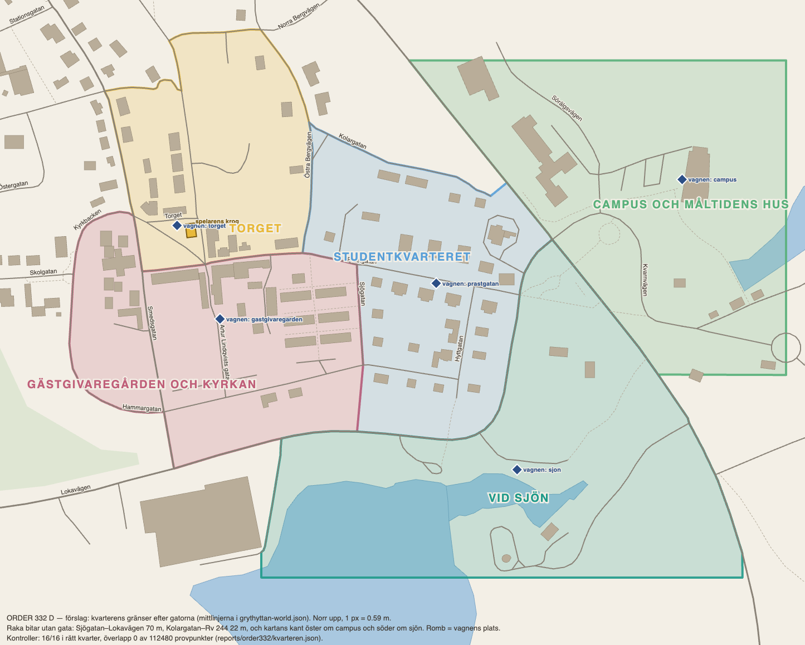

# ORDER 332 — etapp 1: figurerna, Grillstugan och kvarteren (rapport)

*Anders 2026-10-13. Gren `order-332` från main `32d19013`.*

**Att godkänna:** kvarterens gränser på bilden i D, och svaren på frågorna under *Öppet* sist.

## A. Leveranserna
Oförändrade i `documentation/leveranser/`:
- D12 (zip 47): `nexus-leverans-2026-10-11-d12-levande-figurer/`
- D13 Grillstugan (zip 49): `nexus-leverans-2026-10-12-grillstugan/`
- D15 (zip 50): `nexus-leverans-2026-10-12-d15-lokalerna-och-platserna/`. Zip 51 har samma innehåll som zip 50.

Zip 48 är Designs hela projektmapp (1 GB) och inte ett leveranspaket, så den ligger inte i repot.

**Avsnitt 7 i visionen** finns i Anders fil `VISION_KVARTER_OCH_SPELLAGEN (1).md` men inte i `documentation/foundation/vision/KVARTEREN_KONKURRENSEN_SPELLAGEN.md`. Jag har inte ändrat foundation, eftersom det är projektledningens. Byggt efter avsnitt 7 i Anders fil. **Förslag:** för in avsnitt 7 i filen i repot.

## B. D12: figurerna lever
- **Talen:** `sim/balance.ts FIGURE_LIFE`, med prototypens värden.

  | Temperament | Gesten | Ansiktet | Övergång | Svarar efter |
  |---|---|---|---|---|
  | Lugn | 0,8 | 0,85 | 0,5 s | 0,45 s |
  | Livlig | 1,3 | 1,15 | 0,3 s | 0,25 s |
  | Reserverad | 0,6 | 0,7 | 0,6 s | 0,6 s |

  - Intensiteten: svag 0,8, tydlig 1,0 och stark 1,2. Ansiktet följer med 0,5, 1,0 och 1,3. Gränserna är 0,34 och 0,67 av trycket.
  - Var femte gäst använder vänster hand.
  - Temperamentens andelar per gästgrupp är lika, eftersom Design inte angav andra.
  - Inget tal hänger på avståndet, så kamerans mått i `reports/order325/kamera.json` gav ingen ändring.
- **Ryggsäcken, luvan och kameran** sitter rätt (`guestGroups.ts`, `checkCarried`).
- **Ansiktena:**
  - Ansiktet går över hörn för hörn mellan uttrycken. Figurerna blinkar och har blickar (`figureFace.ts`).
  - Livet i vila och temperamentets storlek på gesten ligger i `figureLife.ts`. Varje bildruta: `liveFrame` efter `applyPose`. Reducerad rörelse respekteras.
- **Varianterna A och B** av de vanliga gesterna (29 nya klipp, 224 i allt). Två grannar gör aldrig samma variant samtidigt (`pickVariantApart`).
- **Svaren:**
  - lyssna;
  - poängen landar;
  - leendet sprider sig;
  - den som berättade skrattar tillbaka (`moodGestures.ts partyPlan`);
  - personalen nickar åt en gäst i förbifarten (`applyPassNod`);
  - vid vagnen pratar ståborden i tur och ordning (`conversationAt`), och Nils nickar längs kön.
- **Var det spelas:** i vinbaren och bistron (`WineBarFigures.tsx`), vid vagnen (`PlayerTruckCrew.tsx`) och på gatan (`StreetRigs`, livet utan ansikte).
- **Barnet och föräldern:** 0,81 m isär, barnet 0,10 m före (`DISTRICT_STREET.style.childSideM`, `childAheadM`).
- **Inte gjort:**
  - Svaren `staffSpeaks` och `badNews`: vinbarens simulering har inget slutsålt eller halvt grepp att utlösa dem.
  - `checkCarried` körs i testerna men inte i bildrutans kontroll.
- **Test:** `scene/__tests__/order332Figurer.test.ts`, 22 tester.

## C. Grillstugan
- **Vagnen:** Grillstugan (D13) ersätter släpet från D7 (`scene/grillstugan.ts`, `playerTruck.ts makePlayerTrailer`).
  - Två står i vagnen, på golvet 0,38 m.
  - Taket och markisens duk tonar ut som husens tak (26–40 m).
- **Avvikelser från D13:**
  - Inga punktljus; lyktorna lyser med eget sken.
  - Grillens rök, sopkorgen och såserna är spelets egna från D9 och D10.
  - Elstolpen står vid västra gaveln [−3,7; −0,85] i stället för [−1,6; −2,45]. Där stod den på körbanan vid Prästgatan och Gästgivaregården.
- **Markisen i butiken** (`EQUIPMENT.queueAwning`, fliken Utrustning när verksamheten är foodtrucken):

  | | |
  |---|---|
  | Pris | **4 500 kr**. Tre veckors platsavgift och under en halv veckas vinst för vagnen, billigare än vinbarens billigaste utrustning (avecvagnen 8 000 kr). |
  | Krav | **Brons i Kalastorget** (kön och tålamodet) och **10 krediter**, hälften av vinkylens. |
  | Syns | Bara när den är köpt (`stuganStateFor`, `applyStuganState`). Stolparna, festongerna och glödlamporna står kvar på krogens nivå, så att det syns från 24 m att den är köpt. |

- **Kön i regn** (`RAIN_QUEUE`, D13):

  | | Med markis | Utan markis |
  |---|---|---|
  | Kön | sex under markisen, 0,55 m mellan | en under luckans skiva, sedan med paraply och 0,9 m mellan |
  | Torra | 7 | 2 |
  | Nils | under markisen och skriver | med paraply utanför kön, lyssnar |

  Köns promenad följer den kö som gäller. Förut gick den alltid mot den torra kön.
- **Hur länge kön står kvar i regn** (`RAIN_QUEUE_BALANCE`):
  - **Förut:** regnet ändrade bara flödet (`TRUCK_WEATHER.footfall.rain` 0,8). Kön vid vagnen stod kvar som torrt.
  - **Nu:** den som står i regnet utan tak över sig går efter **0,75** av köns tålamod (45 av 60 sim-sekunder).
  - Står fler än **10** i regnet går den sista.
  - Markisen ger tak åt de sex första.
  - Regnet bestämmer hur länge kön står kvar, inte humöret hos dem som står kvar under paraplyet. Torrt sjunker inte nöjdheten i vagnens kö, och då gör den det inte i regnet heller.
  - Kön är den som scenen ritar (`sim/truckLife.ts truckQueueLine`, läst av både `service.ts` och `truckGuestFlow.ts`).
  - De som går räknas i `day.truckRainLeavers`. De går utan slag mot ryktet eller moralen: de såg kön i regnet och gick.
- **Två fel som mätningen hittade:**
  1. **Regnet nådde inte kön.** Den första versionen läste gäster i läget `waiting`. Vid vagnen står högst en gäst där i spelarens flöde, eftersom kön som ritas är gästerna som beställer.
     - Regnet ändrade därför ingenting: 17 rader × 40 frön var lika med före till kronan (`reports/order332/efter-f96d20d7/`), också med tålamodet 0,1.
     - Rättat i `9c57e139`.
  2. **Ryktet föll.** Den andra versionen sänkte nöjdheten hos dem som stod i regnet, och ryktet följde med (`reports/order332/efter-f6e7d17e/`, kolumnen `regn1` i `jamforelse.json`):
     - 0,6-raderna nådde aldrig vinbaren (10 av 40 före);
     - stjärna 0,75 nådde den i 26 av 40 (40 före).
     Det var mer än ordern bad om, så nu bestämmer regnet bara vem som går. Rättat i `6e9a0a35`.
- **Talen valda ur en mätning:** en regnkväll i spelarens flöde, 8 frön, med och utan markis och sju inställningar (`reports/order332/regn.json`, `strategic/testHarness/__tests__/order332Regn.test.ts`).
  - Med 0,75 och 10 kostar en regnkväll utan markis 11 % av notorna (`rows[1].kostnadUtanMarkis.billsShare`). Det mesta är taket `leaveAt`.
  - Markisen vinner tillbaka 3,25 notor och 615 kr per regnkväll (`rows[1].markisensVinst`). Det är den tydligaste vinsten bland inställningarna.
  - Markisen kostar 4 500 kr och betalar sig efter omkring sju regnkvällar. Regn kommer ungefär var femte kväll, så det tar fler veckor än de flesta står vid vagnen. Att köpa den är ett omdöme.
  - Skillnaderna mellan inställningarna är små med 8 frön och delvis brus.
- **Ändrat med vagnen:**
  - Träden och samlingarna står inte i vagnen på någon av platserna. Skylten följer platsen.
  - Facklan vid kön är flyttad 0,45 m från markisens stolpe.
  - Grillvagnens skylt (ft13) kommer bara när vår vagn står på Torget.
- **Inte gjort:**
  - Väggarna inom 12 m från vagnen kapas inte vid Z (D15:s förslag). Byns hus har ingen sådan mekanism; bara vårt eget rum har den.
  - D13:s himmel i regn används inte, eftersom byns himmel följer byns väder. Vagnens blöta trä och plåt är med.
  - Bord A i regn (`RAIN_TABLE`) står till största delen utanför skivan, som i D10. Flyttas det in under skivan står det på hämtplatsen. Fråga till Design.
- **Test:** `scene/__tests__/order332Grillstugan.test.ts`, 14 tester.

## D. Kvarteren
**Gränserna följer gatornas mittlinjer** (`content/districtBorders.ts`, `content/districts.ts`).

*Bilden: `frontend/reports/order332/kvarteren.png`. Data och kontroller: `kvarteren.json`, och skriptet `scripts/order332-kvarteren.mjs`.*

| Kvarter | Gränsen |
|---|---|
| Torget | Kyrkogatan, Nygatan, Västra, Norra och Östra Bergvägen, Prästgatan, Torget, Smedsgatan |
| Studentkvarteret | Prästgatan, Sjögatan, Lokavägen, Hälleforsvägen (Rv 244), Kolargatan, Östra Bergvägen |
| Gästgivaregården och kyrkan | Smedsgatan, Torget, Prästgatan, Sjögatan, Lokavägen, Hammargatan, Kyrkbacken |
| Campus och Måltidens hus | Rv 244 och kartans kant i öster och norr |
| Vid sjön | Lokavägen, Rv 244, Rv 205, kartans kant söder om sjön och servicevägen i väster |

- **Kontrollerna:** 16 av 16 rätt. Vagnens fem platser, vår krog, Gästgivaregården, kyrkan, Måltidens hus, Kärnhuset, källaren och salongen ligger var och en i sitt kvarter. Överlapp: 0 av 112 480 provpunkter (`kvarteren.json`).
- **Raka bitar utan gata:**
  - Sjögatan–Lokavägen, 70 m.
  - Kolargatan–Rv 244, 22 m.
  - Kartans kant öster om campus och söder om sjön.
- **Magasinsgatan** står i visionen under studentkvarteret, men på kartan ligger den 300–400 m väster om Torget, långt från Prästgatan. Den är inte med. Anders avgör.
- **Namnen på nivån Byn:**
  - Ett namn per kvarter tonar in mellan 400 och 560 m. På Byn (660 m) syns alla, och från 210 m och närmare inget.
  - Lugnare än krogarnas skyltar: versaler utan ruta.
  - De ger plats åt krogarnas skyltar (`DistrictLabels.tsx`, `LabelDeclutter.tsx`).
- **Gästerna på gatan per kvarter** (D15 `STREET_MIX`, `balance.ts DISTRICT_STREET`):
  - Studenterna går tre och tre med ryggsäck, och var fjärde har bråttom.
  - Turisterna går långsamt och stannar och tittar.
  - Gourmeterna och konferensfolket går i par, konferensfolket pratande.
  - Vid sjön går en vuxen och ett barn hand i hand: nio på stigen en sommarhelg i öppen badsäsong utan regn, annars två.
- **Krogens gäster på gatan:** de som är på väg till en krog behåller sin grupp ur simuleringen.
- **Test:** `scene/__tests__/order332Kvarteren.test.ts`.

**Plånbok och kräsenhet** (`balance.ts DISTRICTS`). Torget är dagens modell, och de andra kvarteren är avvikelser från den:

| Kvarter | Gästerna (student/medel/hög) | Plånboken: prisets vikt × | Kräsenheten | Kvaliteten de läser |
|---|---|---|---|---|
| Torget | byns (0,3/0,5/0,2) | 1 | 0 (dagens) | ryktet och stjärnorna |
| Studentkvarteret | 0,75/0,25/0 | 1,6, gränsen × 0,85 | 0 (stjärnorna gäller inte studenter) | ryktet |
| Gästgivaregården | 0,05/0,4/0,55 | 0,5, gränsen × 1,5 | 3 | helheten: den svagaste av rätten, vinet och servicen (förlåter minst) |
| Campus | 0,2/0,35/0,45 | 0,8, gränsen × 1,2 | 3 | medaljerna från Måltidens hus |
| Sjön | 0,1/0,75/0,15 | 1 | 0, stjärnorna × 0,6 | ryktet |

**Kvällarna skiljer sig** (`sim/districts.ts districtTonight`, alla tal i `DISTRICTS.list`):

| Kvarter | Faktorer |
|---|---|
| Studentkvarteret | Vardagar och torsdagens AW starkast. Terminen × 1,15, sommarlovet × 0,45. |
| Gästgivaregården | Sommaren × 1,25–1,3, avtagande mot vecka 8. Helgen starkast. |
| Campus | Konferensdagarna (tisdag–torsdag veckorna 2, 4, 6 och 7) × 1,9. Lördagen × 0,4. |
| Sjön | Sommarhelg i sol stark, en regnig vardag nästan tom. Stängd efter vecka 6 (badsäsongen). |
| Alla utom Torget | Marknadsdagarna × 0,85–0,9. Folk går till torget. |

**Säsongen:** spelets kalender är sommaren (vecka 1 midsommar, vecka 8 kräftskivan, `HOLIDAYS`). Därför:
- terminen börjar vecka 8;
- sjön är öppen veckorna 1–6;
- marknadsdagarna är Grythyttedagarna (vecka 3, fredag och lördag), torgets bästa dagar.

Höstmarknaden (avsnitt 7 punkt 5) ligger utanför en sommarsäsong. Byns bild är kalibrerad mot hösten (25 september), så kalendern och bilden säger olika saker. Se *Öppet*.

**Rivalerna** i `VILLAGE.rivals` delas av alla kvarter tills de blir AI-krogar per kvarter i etapp 2 (avsnitt 7 punkt 4). Står vagnen i ett annat kvarter än Torget tas spelarens gäster inte ur torgets pool.

## E. Gästens val
`sim/village.ts venueWeight`: smaken × stjärnorna × priset × kvaliteten.
- **Plånboken:** prisets exponent × `walletPriceK` och gränsen gästen helst betalar × `walletComfortK`.
- **Kräsenheten:** kvaliteten väger exp(kräsenheten × (kvaliteten − 0,5)).
- **Kvaliteten:**
  - Spelarens: `qualityFood`, `qualityDrink` och `qualityService`, det rummet visar (`sim/districts.ts playerQuality`). Den svagaste av de tre gäller vid Gästgivaregården.
  - På Campus: medaljstegen mot alla möjliga.
  - Rivalernas: efter nivån, Enkel 0,35, Mellan 0,55 och Exklusiv 0,8.
- **Notan vid vagnen** följer kvarterets gäster: studenterna betalar mindre och de betalningsstarka mer (`GUEST_TYPES.legacyBillFactor`, `guestTypes.ts typeShares`).
- **Test:** `sim/__tests__/order332Kvarteren.test.ts`.
  - Bättre kvalitet ger mer än dubbel andel vid Gästgivaregården.
  - En dyr nota straffas hårdare bland studenterna.

## F. Spelarens krog på Torget
- Vinbaren och bistron står på Torget (`PLAYER_DISTRICT`).
- Torget har alla faktorer 1, ingen kräsenhet och byns blandning.
- Testet visar att vikten på Torget är densamma som utan kvarter, för varje kvalitet, och att Torgets kväll är 1 varje dag i säsongen och i alla väder.
- Mätningen under H visar samma sak i 40 säsonger per rad.

## G. Vagnens fem platser
- **Platserna:** D15 `SPOTS` i `strategic/content/truckSpots.ts`, läst genom `sim/districts.ts`.
  - **Prästgatan är flyttad 0,2 m** längs vagnens +z till [290,63; 39,17]. Annars står Grillstugans bakvägg på trottoaren (`onRoadAudit.ts`, toleransen 0,1 m). Det är en avvikelse från D15.
  - Campus står på den nya punkten [550,30; −70,42]. Grillvagnen flyttas 1,5 m norrut där när vår vagn står på campus.
- **Morgonrutan** (`business/TruckSpotPicker.tsx`): fem rutor med namnet och avgiften.
  - Under rutorna står vilka gäster kvarteret har, och vad som gäller i kväll: terminen, konferensen eller marknaden.
  - Inget tal om hur många som kommer, eftersom spelaren ska läsa kvarteret.
  - Valet görs med `SET_TRUCK_SPOT` (`sim/truckSpot.ts`) på morgonen och står kvar tills det byts.
- **Avgiften per kväll** (`DISTRICTS.truckSpotFeeSek`), dragen när dörrarna öppnar:

  | Plats | Avgift per kväll |
  |---|---|
  | Torget | 0 kr, ingår i veckans tillstånd (1 500 kr) |
  | Prästgatan | 150 kr |
  | Campus | 250 kr |
  | Sjön | 300 kr |
  | Gästgivaregården | 350 kr |

- **Sjön** går inte att välja efter vecka 6. Står vagnen där när badsäsongen slutar kör den till Torget.
- **Vagnen, kön, laget, gästerna, skylten och kameran** står på platsen (`VillageVenues.tsx`, `PlayerTruckCrew.tsx`, `playerTruckPlacement`).

## H. Mätningarna
**Spelartyperna,** 17 rader × 40 säsonger (`scripts/order327-harness.sh`), kört i en egen worktree:

| Mätning | Var den ligger | Commit |
|---|---|---|
| Före | `reports/order332/fore/` | main `32d19013` |
| Efter | `reports/order332/efter/` | `6e9a0a35` |
| Utan regn, regnregeln utan verkan | `reports/order332/efter-utan-regn/` | `f6e7d17e` |
| Den första regnregeln | `reports/order332/efter-f6e7d17e/` | `f6e7d17e` |

Jämförelsen står i `reports/order332/jamforelse.json` (`scripts/order332-jamforelse.mjs`).

- **Ingen rad stänger fler säsonger** (`rowsClosingMore: []`). koncept-soigne-0,6 går från 3 till 2.
- **Torgets tal är dagens:** utan regnregeln är alla 17 rader lika med före i varje fält (`utanRegnSameAsFore: true`). Kvarteren, gästens val och platserna ändrar alltså inget på Torget.
- **Regnet vid vagnen ändrar lite:**
  - 0,6-raderna (enkel, soigne, stjärna) når vinbaren i 8 av 40 i stället för 10, men tidigare: medianveckan 3 mot 6.
  - trappa-mentorn når bistron i 36 av 40 mot 40.
  - Raderna som stannar i vagnen hela säsongen har 1 300–4 900 kr mindre i kassan vid slutet.
  - De andra raderna ligger inom några säsonger och några tusen kronor (se filen).
- **Den första regnregeln:** den sänkte ryktet så att 0,6-raderna aldrig nådde vinbaren. Den står kvar i kolumnen `regn1` som förklaring till C.

**Intäkten per plats och kvarter** (`scripts/order332-platser.sh`, `reports/order332/platser/`, `reports/order332/platser.json`):
- Vagnen står på samma plats hela foodtruck-perioden, 40 säsonger per rad, för tre spelartyper.
- Netto är intäkten per kväll minus platsens avgift (`netPerEveningSek`).
- Vinbaren och bistron ligger alltid på Torget, så tabellen gäller vagnen.

| Plats (kvarter) | mentorn, netto per kväll | rimlig, netto per kväll | slarvig, netto per kväll | slarvig, stängda säsonger |
|---|---|---|---|---|
| Torget (Torget) | 6 279 kr | 6 175 kr | 4 938 kr | 0 |
| Gästgivaregården | 6 188 kr | 5 988 kr | 2 596 kr | 0 |
| Campus | 5 031 kr | 4 771 kr | 1 510 kr | **12 av 40** |
| Sjön | 4 993 kr | 4 715 kr | 3 022 kr | 0 |
| Prästgatan (Studentkvarteret) | 4 246 kr | 4 207 kr | 1 847 kr | 0 |

- **Gästgivaregården** ger de kunniga mest per kväll före avgiften (mentorn 6 538 kr mot Torgets 6 279 kr). Efter avgiften är den ungefär lika med Torget. Den slarviga får där hälften av Torgets.
- **Campus** väger medaljerna. Den slarviga har få, och om hen står där hela säsongen går krogen i konkurs i 12 av 40 säsonger.
- **Prästgatan** är svag i en sommarsäsong, eftersom studenterna är lediga till vecka 8. rimlig där stänger 1 av 40.
- **Sjön** är stängd veckorna 7–8, och då står vagnen på Torget.
- **Raderna med en fast plats är nya.** Spelaren byter plats efter kvarteret; detta visar vad platsen ger. Att en dålig plats kan stänga krogen är omdömet som ordern ber om, men talen kan behöva ses över om det blir för hårt.

## Kontroll i webbläsaren
Produktionsbygget och spelarens flöde från en sparfil, måndag vecka 2 i foodtrucken (`scripts/order332-check.mjs`, `reports/order332/kontroll/check.json` och bilderna i samma mapp):
- **Morgonrutan:** fem rutor med namnet och avgiften, den valda fylld. Under dem kvarterets gäster och kvällens läge, till exempel "Studenterna är lediga". Kontrollerat i 1280 × 720 och 1024 × 600.
- **Vagnen på varje plats:** valet görs med knappen. Efter "Öppna" landar kameran på 12 m vid vagnen på alla fem platserna (`vagnen-<plats>-Z-1280x720.png`).
- **Regn:** utan markis står kön glesare under paraply. Med markis står stolparna och festongerna kvar vid Z (`regn-utan-markis-Z`, `regn-med-markis-Z`).
- **Byn under servicen:** alla fem namnen syns (`visible`), och under varje namn ligger duken och ingen panel (`free`, läst med `elementFromPoint`).
  - Gästgivaregårdens namn låg först under Grillvagnens skylt. Torget, Studentkvarteret och Campus låg under HUD:ens övre rad.
  - Namnen är flyttade inom kvarteren, och långa namn går på två rader (`districtBorders.ts labelAt`).
## Tester och typecheck
- `npm run typecheck` och `npm run build` är gröna.
- **Hela testsviten ensam** (`npx vitest run`, inget annat kördes samtidigt): 233 testfiler gröna, 17 överhoppade. 2 886 tester gröna, 1 förväntat fel och 22 överhoppade.
- **Nya testfiler:**
  - `sim/__tests__/order332Kvarteren.test.ts` (D–G i simuleringen);
  - `strategic/scene/__tests__/order332Figurer.test.ts` (B);
  - `strategic/scene/__tests__/order332Grillstugan.test.ts` (C, med regnet i spelarens flöde);
  - `strategic/scene/__tests__/order332Kvarteren.test.ts` (D i bilden);
  - `strategic/testHarness/__tests__/order332Regn.test.ts` (mätningen av regnet, körs med `REGN_SEEDS`).
- **Ändrade tester:**
  - `order309Foljder` (rummets utrustning utan markisen);
  - `order286aTheatre` (antalet klipp 195 → 224);
  - `order325`, `order326` och `order327` (`pickGesture` ger nu ett objekt; tempot efter intensiteten);
  - `order273NoSwedishPlayerText`: Gästgivaregården är ett egennamn, och kvarterens gränsdata är gatunamn ur kartan, som `roadRoles.ts`.
- **Den första körningen av sviten** hade två fel, båda i ORDER 273-testet (gatunamnen i `districtBorders.ts` och "Gästgivaregården" på engelska). De är rättade i `5f1643c9`, och den andra körningen ovan är hel.
- **Harnessens nya möjlighet:** `KARNAN_TRUCK_SPOT` ställer vagnen på en plats (`order296Karnan.test.ts`, `truckBySpot` i utdata).

## Öppet
1. **Gränserna:** godkänner Anders bilden? Magasinsgatan och de raka bitarna (Sjögatan–Lokavägen 70 m, Kolargatan–Rv 244 22 m).
2. **Säsongen:** kalendern är sommar och byns bild höst. Ska säsongen vara sommar (som nu: terminen vecka 8, sjön veckorna 1–6, marknaden är Grythyttedagarna) eller höst (höstmarknaden, terminen hela säsongen, sjön stängd)?
3. **Avsnitt 7** in i `KVARTEREN_KONKURRENSEN_SPELLAGEN.md`.
4. **Väggarna inom 12 m från vagnen vid Z** (D15): behöver en ny mekanism för byns hus. Egen order?
5. **Bord A i regn:** fråga till Design.
6. **Campus för den slarviga:** står vagnen där hela säsongen stänger krogen i 12 av 40 säsonger (H). Det är omdömet, men om det är för hårt kan Campus kräsenhet (3) eller avgiften (250 kr) sänkas.
7. **Kontrollen i webbläsaren, två iakttagelser utan slutsats:**
   - I tre körningar stod klockan still på 19.21 medan skriptet svarade på kvällens första situationskort. Figurerna rörde sig, men klockan och nedräkningen stod. När kortet fick gå ut av sig självt gick klockan (`check.json clock`).
   - Varje sida har en resurs som ger 404. Den finns också på main `32d19013` och hör inte till ordern. Playwright ser inte adressen.
8. **Lokalerna i D15** byggs i ORDER 333. Husen w193810970, w193810957 och Kärnhusets östra flygel (Flygeln) väntar på Anders sista ord.
