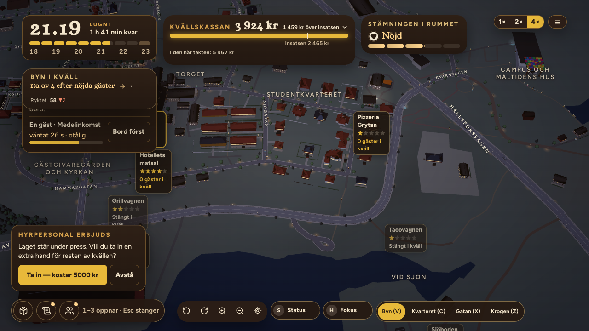
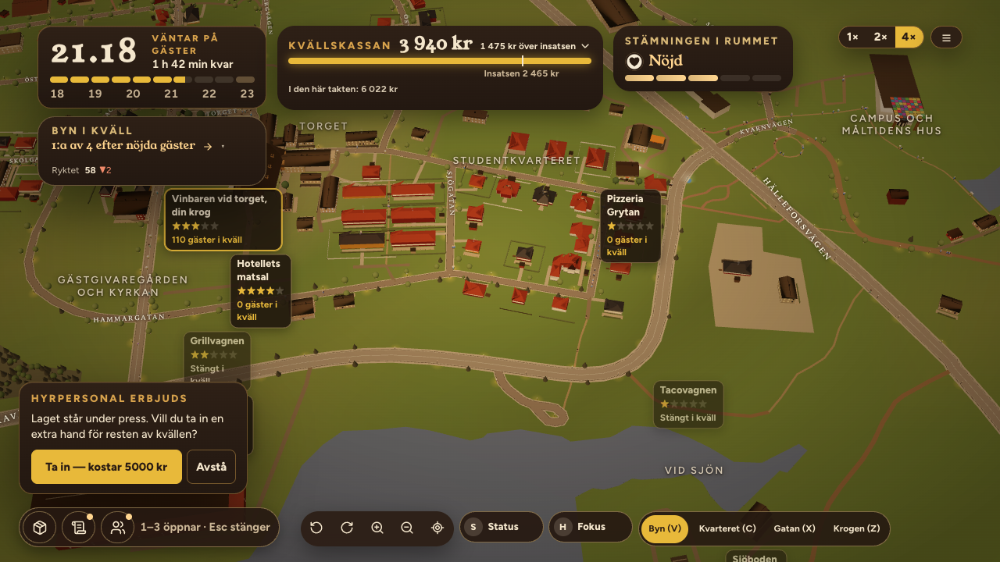
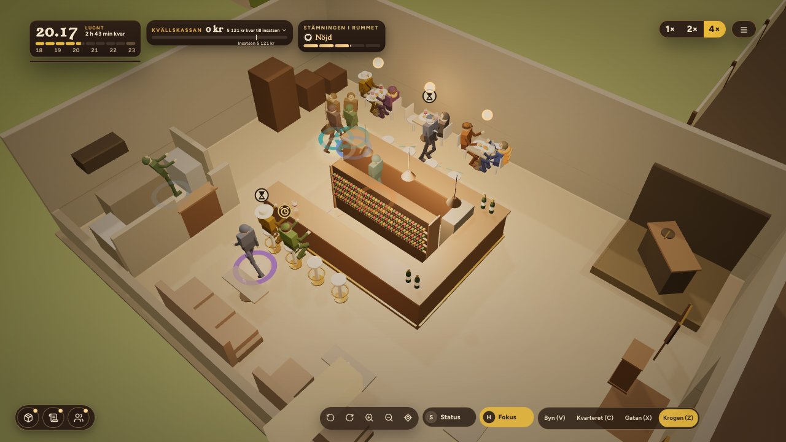

# ORDER 333 — lokalerna, sommaren och uppföljningen av 332 (rapport)

*Anders 2026-10-21. Gren `order-333` från main `44c5b9ea`.*

**Att avgöra:** frågorna under *Öppet* sist, särskilt källaren (punkt 1) och Magasinsgatan (punkt 2).

## A. Visionen
Avsnitt 7 (beslut 12 oktober) och avsnitt 8 (beslut 21 oktober) står i `documentation/foundation/vision/KVARTEREN_KONKURRENSEN_SPELLAGEN.md`. Ändringen är godkänd av Anders (commit `ea6f5cb1`).

## B. Magasinsgatan, vagnens sjätte plats
- **Platsen:** `content/truckSpots.ts` `magasinsgatan`, C [−234,76; 49,74], th 2,0493, på gatubiten `w1329020064`.
  - Gästerna är Torgets (`district: 'torget'`).
  - Platsen ligger utanför kvarteren (`outsideDistricts`, `districtAt` ger null).
  - Valet syns i morgonrutan (`spot.name.magasinsgatan`).
- **Avgiften:** 100 kr per kväll (`balance.ts DISTRICTS.truckSpotFeeSek`), den lägsta av platserna.
- **Läget är sökt längs gatan** med D15:s prov för de fem platserna:
  - lådan runt vagnen utan hus, vatten och körbana;
  - Grillstugan, däcket och föremålen utan väg och trottoar;
  - ingen köplats på körbanan.

  3 679 lägen klarar provet. Det valda har skylten 0,6 m från trottoaren och ligger 262 m från Torget, närmast byn av gatans lägen (`reports/order333/magasinsgatan.json`, `chosen`).
- **Om "på riktig trottoar":** Grillstugan och föremålen får inte stå på trottoaren, enligt samma regel som på de andra platserna (`onRoadAudit.ts`, 0,1 m). Därför står kön på gräset strax innanför trottoaren, och skylten står vid trottoarkanten.
- **Intäkten:** se H nedan. Platsen är Torget minus avgiften (*Öppet* 2).
- **Test:** `scene/__tests__/order333Magasinsgatan.test.ts`.

## C. Byn i sommarskrud
- **Säsongen som syns är sommaren** (`village/summer.ts`; `lib/devToggles.ts`, förvalet `summer`). Hösten ligger kvar bakom DEV-växeln J för jämförelse.
- **Ljuset:** sommarkvällens himmel `SUMMER_SKY`.
  - Servicen börjar i eftermiddagsljus.
  - Solnedgången kommer mot slutet.
  - Kvällen slutar i en ljus sommarnatt, ljusare än höstens skymning.
  - Talen är Codes val tills Design levererar en sommarkväll. D15:s sommar var förebilden.
- **Grönskan:** markens färger på sommaren, `SUMMER_GROUND` (`OsmTerrain.tsx`).
- **Folk på gatan:** 1,6 gånger så många gående i byn och i kvarteren (`SUMMER_STREET.walkersK`, `OsmPedestrians.tsx`). Efter ändringen är det 254 gående (`reports/order333/sommar.json`, `efter.shots.*.walkers`). Före ändringen publicerade sidan inte talet.
- **Före och efter**, samma klockslag i produktionsbygget (`scripts/order333-sommar.mjs`): `frontend/reports/order333/sommar/fore-*.png` och `efter-*.png`. Bilderna visar dörrarna öppna, 19.30 och 21.00 på nivåerna Byn och Gatan.

- **Inte gjort:**
  - Sjön ser fortfarande grå ut på nivån Byn. Den tar himlens färg (`EveningAccents.tsx`), och ljuset gör den grå.
  - Antalet tända fönster är som förut. D15:s sommar tänder färre.
- **Bussens scen (`src/scene/Scene.tsx`)** läser samma växel och har nu sommarens sol.

## D. Lokalerna
- **Valet:** när vinbaren tas över väljer spelaren lokal i erbjudandet (`business/PremisesPicker.tsx`, i `LadderOfferCard` och `OwnerOfferScreen`). Alternativen är Torget som i dag, Källaren, Salongen och Flygeln. Under valet står vilka gäster kvarteret har.
- **Simuleringen:** `sim/districts.ts PREMISES`, `economy.premises`, `LADDER_TAKE { premises }` (`sim/ladder.ts takeOffer`).
  - Lokalens kvarter styr gästerna (`playerDistrictOf`).
  - Klassen, lånet och insatsen är desamma i alla lokaler.
  - Bistron byggs om i samma lokal.
  - Test: `sim/__tests__/order333Lokalerna.test.ts`.
- **Valet syns i världen. Anders beslut 2026-10-21: rummet flyttas.**
  - Vinbarens rum, möbler och figurer står i lokalens hus i D15:s ram (`content/premises.ts`, `content/playerPremises.ts`).
  - Rummet med väggarna ligger innanför husets mått i alla tre lokalerna (`reports/order333/rummet.json`, `cornersInsideHouse` = 4).
  - Gästerna går till dörren vid entrén, och kamerans Krogen (Z) och Gatan (X) följer med.
  - Huset vid torget blir ett vanligt hus när vinbaren står någon annanstans.
  - Scenen monteras om när lokalen byts (`StrategicApp.tsx`).
  - Torget är som förut: samma rum och samma tal (`order333RummetILokalen.test.ts`).
- **Kontrollen i produktionsbygget:** vinbarens sparfil med lokalen satt, servicen öppen (`scripts/order333-lokal.mjs`). Bilderna ligger i `frontend/reports/order333/lokal/<lokal>-krogen|gatan|byn.png`, och klockan och nivån för varje bild står i `lokal.json`.

- **Avvikelser från D15:**
  - **Källaren** har vinbarens rum i gatuplan, utan valv och trappa. D15:s källare ligger 2,7 m under gatan med 0,45 m murar och är 9,79 m djup innanför. Vinbarens möblering kräver 10,0 m (`wineBarHouse.ts MIN_SIZE`).
  - **Entrén** sitter på rummets kortsida, där vinbarens möblering har den. Den ligger i husets +x-ände, närmast D15:s dörr. I källaren och salongen sitter D15:s dörrar på långsidan.
  - **Salongens rum** står i husets västra 15 m mot dörren (`offsetX` 7,0). Resten av huset är tomt.
  - **Flygeln** ligger i Kärnhuset, som är ett handbyggt block med tak över hela huset. Kärnhuset döljs därför vid krogens nivå när vinbaren står där (`CraftedLandmarksD2.tsx`). På Gatan och Byn står det kvar, och vinbaren syns genom sin etikett.
  - D15:s egna interiörer (valven, ljuskronorna, glaset och platserna 44/35/36) är inte byggda.
- **Mätningen:** spelartyperna, 40 säsonger per rad, med lokalen fast från övertagandet (`scripts/order333-lokaler.sh`, `KARNAN_PREMISES`; jämförelsen `scripts/order333-jamforelse.mjs`). Talen står i `reports/order333/lokaler.json`.
  - **Torget är dagens:** alla tre rader är lika med ORDER 332 i alla fält (`torgetSameAs332: true`).
  - **Salongen:** ingen rad stänger fler än på Torget (`premises.salongen.*.closedMoreThanTorget332` = 0).
  - **Flygeln:** den mittersta raden stänger 3 säsonger fler (`premises.glashornet.trappa-rimlig.closedMoreThanTorget332`).
  - **Källaren:** den starka raden stänger 40 av 40 säsonger och den mittersta 32 av 40 (`premises.kallaren`). Se *Öppet* 1.
  - **Den svaga raden** når aldrig vinbaren, så lokalen spelar ingen roll för den.

## E. Väggarna nära vagnen
- **Mekanismen:** väggarna på byns hus inom 12 m från vagnen går ned till 1,6 m medan taken tonar ut (40 → 26 m, `roofAt`). Taket, listerna och fönstren på de husen döljs när väggarna är kapade (`scene/village/wallCut.ts`, i `OsmBuildings`, `ProceduralFacades` och `VillageWindows`). Det följer D15.
- **Lokalerna:** samma mekanism, med lokalens hus som mitt.
- **Husen som kapas** (`reports/order333/vaggarna.json`):
  - Torget: `w869907973`, 11,5 m;
  - Prästgatan: `w193810970`, 7,9 m;
  - de andra platserna har inga hus inom 12 m.
- **Kapas inte:** landmärkena är handbyggda och kapas inte. Det gäller spelarens hus vid torget och Måltidens hus vid Campus, som står bakom Grillstugan, inte mellan kameran och kön.
- **Test:** `scene/__tests__/order333Vaggarna.test.ts`.

## F. Vart gästerna gick och varför
- **I kvällens resultat:** en rad per gästgrupp i kvarteret (`ResultScreen.tsx WhereGuestsWentPanel`; `sim/village.ts whereGuestsWent`). Raden säger hur stor andel som valde vilken krog, varför, och hur stor andel som valde spelaren.
- **Exempel från Campus en konferensdag:** "Höginkomst: 77 % valde Hotellets matsal, de frågade efter medaljer. 8 % valde dig."
- **Hur skälet bestäms:**
  - Andelarna räknas med samma vikter som gästens val (`playerChoiceShare`). Testet visar att de vägda andelarna ger spelarens andel.
  - Skälet är den faktor där vinnaren ligger längst före den den jämförs med: smaken, ryktet, priset eller kvaliteten. Kvaliteten heter medaljer på Campus och helheten vid Gästgivaregården.
- **Ingen andel står utan ett skäl** (`sim/__tests__/order333VartGasternaGick.test.tsx`).

## G. Klockan på 19.21
- **Mätningen:** i produktionsbygget och spelarens flöde vid vagnen stod klockan aldrig still (`reports/order333/klockan.json`, `clockLongestStillSeconds` = 0 i alla körningar). Tre körningar: svara, vänta, och ORDER 332:s tangenttryck (`fore-tangenter`).
- **Det som ser ut som stillastående:**
  - Under situationskortet går spelet i 1× (ORDER 314, `consequence.ts effectiveSpeed`). Vid 4× går klockan därför från omkring två spelminuter per sekund till en halv.
  - Efter ett svar står nedräkningen i grått tills avgörandet kommer (ORDER 310b, `IncidentPanel.tsx isFrozen`).
- **Nedräkningen går redan:** när tiden är slut tar personalen över (`reducer.ts` TICK → `resolveIncident(..., timeoutAnswer)`). I körningen `vanta` räknade kortet ned till 1 och stängdes.
- **Ingen rättelse behövdes.** De 19.21 som ORDER 332 såg går inte att återskapa i nuvarande bygge.

## H. 404-resursen
Webbläsaren hämtade `/favicon.ico` på varje sida och fick 404. Spelet har nu en egen ikon (`public/favicon.svg`, länkad i `index.html`). Efter rättelsen ger varken startsidan eller servicen några fel (`reports/order333/404.json`, `efter`).

## I. Bord A i regn
Frågan till Design står i `documentation/leveranser/BESTALLNING_DESIGN_D14.md`, punkt 11, med tre vägar Code ser.

## J. Testsviten
- Hela sviten ensam: 238 filer och 2 901 tester gröna, 25 överhoppade och ett väntat fel.
- Typkontrollen och bygget är gröna.
- Ett test rättat: Kärnhuset är ett egennamn i den engelska texten (ORDER 273-testet).

## Öppet
1. **Källaren stänger krogen.** Med vinbaren i källaren stänger den starka spelartypen 40 av 40 säsonger och den mittersta 32. Källaren ligger i studentkvarteret, och studenterna är lediga på sommaren. Terminen börjar först i vecka 8 (`DISTRICTS.termWeeks`, `outOfTermK` 0,45), så vinbaren står nästan tom i sju veckor.
   - Är det ett omdöme spelaren ska kunna göra, eller är det en fälla?
   - Om det är en fälla kan sommarkurserna ge fler studenter (`outOfTermK`), källaren få lägre hyra, eller valet visa att terminen inte har börjat.
2. **Magasinsgatan är Torget minus avgiften.** Gästerna är Torgets. Simuleringen har ingen avståndsmodell mellan vagnarna, så platsen ger 6 184 kr netto per kväll mot Torgets 6 279 (`lokaler.json magasinsgatan`; `reports/order332/platser.json`). Ingen har skäl att välja den.
   - Ska den ha något eget, till exempel ingen konkurrerande vagn, en egen publik, eller gratis på marknadsdagar när torget är fullt?
3. **D15:s interiörer:** källarens valv, salongens ljuskronor och Flygelns glas, med egna bord och 44/35/36 platser. De kräver ny koreografi för personal och gäster. Det blir en egen order om Anders vill ha dem.
4. **Rubriken på morgonen** säger "Vinbaren vid torget" i alla lokaler. Det är namnet spelaren gav krogen på banken (`bank.name`, "… vid torget"). Ska banken fråga efter namn först när lokalen är vald?
