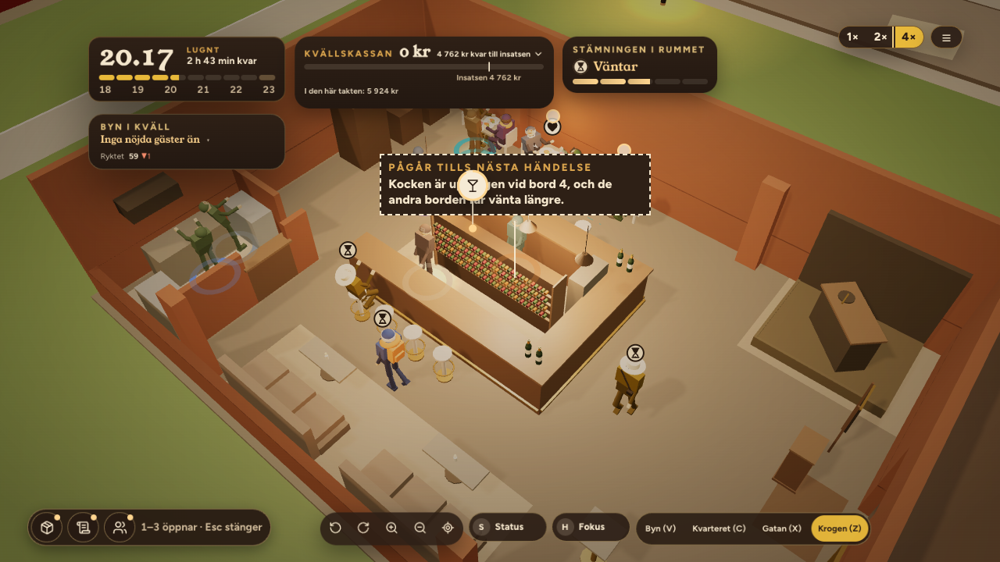
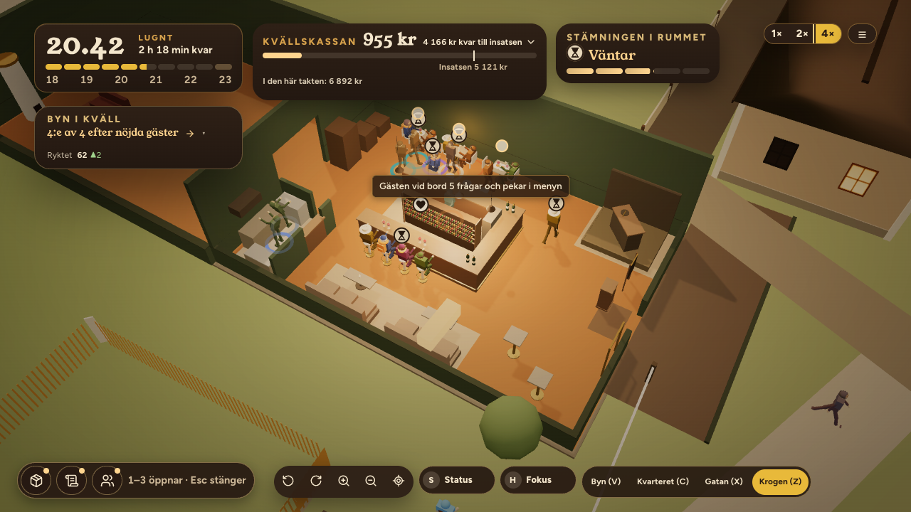
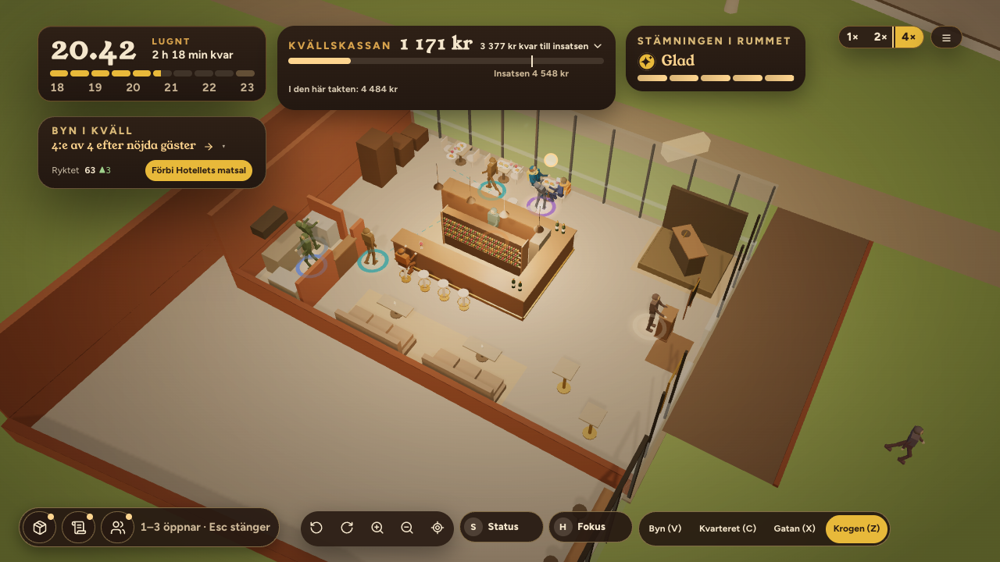

# ORDER 334 — lokalerna får sin karaktär (rapport)

*Anders 2026-10-22. Gren `order-334` från main `1a0e9625`.*

**Att avgöra:** frågorna under *Öppet* sist, särskilt Magasinsgatan (punkt 1) och platserna i lokalerna (punkt 2).

## A. Källaren
Talen står i `src/sim/balance.ts`:
- **Lägre hyra:** `DISTRICTS.premisesRentK.kallaren` = 0,7. Hyran är klassens gånger lokalens faktor (`sim/economy.ts weeklyRentSek`). Den syns vid varje lokal i väljaren (`premises.rent`).
- **Sommarkurserna på campus:** studentkvarteret har studenter också utanför terminen. `DISTRICTS.list.student.outOfTermK` gick från 0,45 till 0,65. Det gäller också vagnen på Prästgatan, se nedan.
- **Byborna på AW:** en ny satsning på morgonen, *AW i källaren* (`AFTER_WORK`).
  - Den går bara när krogen står i källaren och bara måndag till fredag (`sim/districts.ts afterWorkAvailable`). Reducern vägrar den annars, och den står inte i listan.
  - Den kostar 500 kr och ger 12 bybor i kvällens tak, bokade i mellangruppen.
  - **Den syns:** i morgonens lista med raden "12 bybor kommer efter jobbet", med en trottoarpratare utanför källarens dörr de kvällar AW är vald (`scene/premisesInterior.ts setAfterWorkSign`) och med raden i kvällens resultat (`afterWork.came`).
- **Kalibreringen:** först 0,6 och 0,75 (`reports/order334/kal1`). Då klarade sig den mittersta i källaren utan AW bättre än på Torget, och valet av AW spelade ingen roll. Därför valdes 0,7 och 0,65 (`kal2`, 10 frön).

**Före och efter, 40 frön** (`reports/order334/lokaler.json`, `rows`). Före är ORDER 333:s körning med samma frön.

| Rad | Före: stängda | Efter: stängda | Efter: medelkassa | Efter: lägsta kassa |
|---|---|---|---|---|
| Källaren, mentorn (stark) | 40/40 | **0/40** | 17 588 | 2 438 |
| Källaren, rimlig (mitten) | 32/40 | 2/40 | 18 823 | −3 463 |
| Källaren med AW, mentorn | – | 0/40 | 39 304 | 23 441 |
| Källaren med AW, rimlig | – | **0/40** | 28 257 | 12 243 |
| Torget, mentorn / rimlig | 0/40 / 0/40 | oförändrat | 36 424 / 28 976 | |

- **Målen är nådda:**
  - Den starka spelartypen stänger 0 av 40 säsonger, också utan AW. Målet var högst 5.
  - Den mittersta klarar sig med rätt val: 0 av 40 stängda med AW, mot 2 av 40 utan.
- **Utan AW är källaren på gränsen:** lånet omförhandlas i 36 respektive 40 av 40 säsonger. Med AW sker det i 14 och 21. Med AW når mentorn bistron i 24 säsonger. På Torget gör den det i 36.
- **Torgets rader är lika med förut** i alla fält. Ändringarna rör alltså bara källaren och studentkvarteret.
- **Prästgatan (vagnen, rimlig):** nettot per kväll steg från 4 207 till 4 477 kr av sommarkurserna (`prastgatan`; före är ORDER 332:s körning).
- **Harnessen:** `KARNAN_AW=1` väljer AW de morgnar det går (`order296Karnan.test.ts`). Skript: `scripts/order334-lokaler.sh` och `scripts/order334-jamforelse.mjs`.

## B. Magasinsgatan, bybornas gata
- **Gästerna:** gatans gäster är 0,35 av Torgets samma kväll. Vid dörren är de mest bybor: 0,85 bybor, 0,1 studenter och 0,05 betalningsstarka (`DISTRICTS.magasinsgatan`).
- **Stamgästerna:** de blir fler för varje kväll vagnen stått där, 2 per kväll upp till 30 (`truckRegularsTonight`).
  - Kvällarna räknas per plats när dörrarna öppnar, en gång per dag (`economy.truckNights`, `sim/truckSpot.ts`). Kvällar på Torget ger alltså inga stamgäster på Magasinsgatan.
  - Stamgästerna är bokade bybor och kommer också när gatan är tom.
- **Avgiften står kvar,** 100 kr.
- **Det syns i kön:**
  - Stamgästen kommer i samma kläder varje kväll (`truckGuestFlow.ts`, numret i kvällens ordning).
  - Stamgästen har en egen kopp i handen i kön (`PlayerTruckCrew.tsx`).
  - Kvällens resultat säger "{n} stamgäster kom med egen kopp. Vagnen har stått här {nights} kvällar."
  - I produktionsbygget, efter tio kvällar där: 11 stamgäster i kväll och 8 figurer med kopp i bild (`reports/order334/bilder.json`, `B`; bilden `bilder/magasinsgatan-kon.png`).
- **Intäkten** (`lokaler.json`, `magasinsgatan`, rimlig). Byn har ingen stamgäst på Prästgatan, så Prästgatan är jämförelsen i samma band:

  | Kvällar där förut | Magasinsgatan | Stamgäster | Prästgatan |
  |---|---|---|---|
  | 0–4 | 4 621 kr | 4 | 4 305 kr |
  | 5–9 | 5 013 kr | 14 | 4 342 kr |
  | 10–19 | 8 263 kr | 20 | 6 958 kr |

  - Hoppet i det sista bandet kommer mest från kalendern. Den 11:e och 12:e kvällen faller på veckans starka dagar, och Prästgatan hoppar lika mycket.
  - Försprånget mot Prästgatan växer från 7 till 19 %.
  - Mot Torget i ORDER 333 (6 184 kr netto per kväll för mentorn) är Magasinsgatan lägre de första kvällarna. Nettot över alla kvällar är nu 5 038 kr för den rimliga, mot 6 075 kr förut.
  - Vagnen står bara två veckor i harnessen, sedan tar spelarna vinbaren. Därför finns inga kvällar över 20.

## C. Lokalernas egna rum
`scene/premisesInterior.ts`. Förlagan är D15:s `buildVenue` och `VENUES`.
- **Rummens mått** (`content/premises.ts room`): källaren 14,7 × 9,8 m, salongen 28,9 × 10,2 m och Flygeln D15:s femhörning. Golvet har D15:s mått och form (`reports/order334/interiorer.json`, `floorM` mot `d15`).
- **Rummens höjd** (`PREMISES_LOOK`): källarens valv springer vid 2,35 m och når 3,4 m. Salongen är 4,2 m och Flygeln 3,6 m.
- **Källaren** ligger i gatuplan, som du sa går bra.
  - Golvet är sten och väggarna tegel.
  - Taket är två tegeltunnor längs rummet med gördelbågar.
  - Fyra murpelare står mot långväggarna. D15:s pelare mitt i rummet står där vinbarens bar står, så de flyttades till väggarna, i luckorna mellan köket, loungerna, tvåorna och DJ:n.
  - Fönsterbrunnarna sitter högt i norra muren.
- **Salongen:**
  - Vinbaren står i östra änden. Dess västra vägg är en mellanvägg med en öppning in mot salongen.
  - I västra delen finns kakelugnen mot gaveln och soffgruppen med två soffor, en fåtölj, ett lågt bord och en matta.
  - Golvet är parkett och väggarna mörkgröna. De höga fönstren sitter i långväggarna, och två ljuskronor hänger i taket.
- **Flygeln:**
  - Vinbaren står i det sydöstra hörnet, och dess södra och östra väggar är glas från golv till tak med spröjsar.
  - Glaset fortsätter längs resten av flygeln. Norra väggen och väggen mot Kärnhuset är tegel.
  - Fönsterbänken med pallar står längs östra glaset. Golvet är betong och pendlarna hänger i taket.
- **Valet syns i rummet vid Z**, med taket borta och väggarna kapade. Golvet, väggarnas färg, rummets form, glaset, murpelarna, kakelugnen, soffgruppen och fönsterbänken står kvar. Valven, ljuskronorna och pendlarna tonar ut med taket, som i D15.
- **Bilder** från produktionsbygget (`scripts/order334-bilder.mjs`): `frontend/reports/order334/bilder/rum-<lokal>-krogen.png` (Z), `-hela.png` (från Z ett steg ut och vriden) och `-gatan.png` (X).

- **Test:** `scene/__tests__/order334Interiorerna.test.ts`. Det prövar måtten, delarna, att rekvisitan inte står i vinbarens möbler, platser, köplatser eller personalens platser, att taket tonar och att AW-skylten står rätt.
- **Avvikelser från D15:**
  - Platserna är fortfarande vinbarens 20 i alla lokaler. D15:s 44, 35 och 36 platser är inte byggda, eftersom simuleringen och figurernas vägar läser vinbarens möblering. Kakelugnens soffor och fönsterbänkens pallar är rekvisita, inga platser.
  - Ingen trappa ned och ingen sockel med trappsteg i salongen.
  - Dörren sitter i vinbarens kortsida, inte i D15:s långsida.

## D. Banken frågar efter namnet när lokalen är vald
- **Två steg i Åsas erbjudande** om vinbaren, både på morgonen och vid dörren (`business/PremisesTakeSteps.tsx`):
  1. Lokalen väljs, med hyran vid varje lokal. Knappen heter "Till banken".
  2. Banken säger var krogen ligger och frågar efter namnet: "Banken lånar ut till en vinbar i källaren på Prästgatan. Vad ska den heta?" "Ta över" går att trycka först när namnet är skrivet. "Tillbaka" går till lokalen igen.
- **Namnet blir verksamhetens** (`BusinessContext`), och morgonens rubrik läser det (`morning-business-name`).
- **Spelarens flöde i produktionsbygget:** före banken stod "Vagnen" i rubriken. Efter "Källaren", "Valvet" och "Ta över" står "Valvet" (`bilder.json`, `D`; bilderna `bilder/banken-*.png`).
- **Test:** `sim/__tests__/order334Lokalerna.test.tsx` på svenska och engelska.

## E. Sviten
Hela sviten kördes ensam före merge: 240 filer, 2 916 tester gröna (1 väntat fel, 26 överhoppade). Ett test från ORDER 332 rättades: studenterna på sommaren var under hälften av terminens, och sommarkurserna ändrar det med avsikt (`order332Kvarteren.test.ts`). Typkontrollen och bygget är gröna.

## Öppet
1. **Magasinsgatan:** stamgästerna växer synligt, men vagnen står bara cirka 12 kvällar innan spelarna tar vinbaren. Ska platsen löna sig tidigare, med fler stamgäster per kväll, eller är den till för den som stannar i vagnen?
2. **Platserna i lokalerna:** ska källaren få fler och tätare platser (D15: 44) och salongen färre (35)? Det är en ombyggnad av möbleringen, figurernas vägar och simuleringens kapacitet per lokal, alltså en egen order.
3. **Prästgatan:** sommarkurserna ger vagnen där cirka 270 kr mer per kväll. Det följer av att de gäller hela studentkvarteret. Är det rätt?
