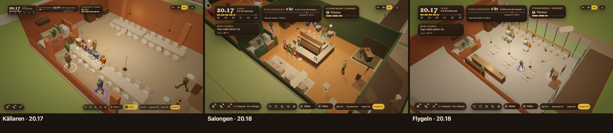

# ORDER 335 — rummen skiljer sig i planlösning (rapport)

*Anders 2026-10-22. Gren `order-335` från main `9b1509e8`. Ordernummer och antal platser: Anders svar samma dag (ny ORDER 335; D15:s antal platser).*

**Att avgöra:** frågorna under *Öppet* sist.

## D. Planlösningarna
Baren står på D15:s plats i varje lokal, och rummen har D15:s antal platser (`d15Manus.js venueLayout`, `VENUE_SEATS`). Planerna står i `src/strategic/scene/tablePlans.ts`.

| Lokal | Platser | Baren | Borden |
|---|---|---|---|
| Källaren | 44 | längs östra väggen norr om dörren, med fyra pallar | två rader långbord om tio, fem per sida |
| Salongen | 35 | i östra änden som nu (vinbarens 20) | väster om mellanväggen: soffgruppen (tre platser) och tre runda bord för fyra med vit duk |
| Flygeln | 36 | mot norra väggen, bort från glaset | tolv pallar längs södra glaset och sex bord för fyra i två rader |

Platserna och barerna är mätta ur rummet som det byggs i spelet (`reports/order335/planlosningar.json`).

- **Köket, förrådet, dörren, värdpulten och köplatserna står kvar** på vinbarens platser i alla lokaler, som när bistron byggdes. Det är därför personalens kök, gästernas kö och kamerans förval fungerar som förut. Baren, borden, platserna och gångarna är lokalens.
- **Vinväggen står på hyllan bakom lokalens bar** i källaren och Flygeln. Den har två lägen, så att platina i Stensöta syns också där: läget bas fyller 60 % av hyllan och är 1,6 m högt, läget platina fyller hela hyllan och är 2,06 m högt.
- **Gångarna och vägarna:**
  - Gästerna går längs lokalens gångar till en punkt bakom stolen och sätter sig därifrån.
  - Personalen serverar från samma sida.
  - I salongen går vägen genom korridoren väster om baren och öppningen i mellanväggen.
  - Testet prövar att ingen väg går genom en möbel, från dörren till varje plats och från bartenderns och servitörens platser till varje sällskap: `scene/__tests__/order335Planlosningar.test.ts`.
- **I simuleringen:**
  - Kapaciteten, sällskapens grupper och ordningen platserna fylls i följer lokalen (`simulation/service.ts premisesSeats`).
  - Grupperna är långbordets sida, bordet, ett par pallar, baren och soffgruppen.
  - Bistron behåller sina 31 platser i alla lokaler.
- **Sida vid sida vid Z** i produktionsbygget, sparfilen måndag i vinbaren med lokalen satt och dörrarna öppna (`scripts/order335-sida-vid-sida.mjs`; `reports/order335/sida-vid-sida.json`, inga fel på sidan):

  Varje rum för sig: `frontend/reports/order335/rum/<lokal>-z.png`.

## Vad platserna gör med spelet
40 frön per rad (`reports/order335/lokaler.json`). Före är 20 platser: källaren ur ORDER 334 och salongen och Flygeln ur ORDER 333. Inga tal i `balance.ts` är ändrade.

| Rad | Före: stängda | Efter: stängda | Efter: medelkassa | Efter: omförhandlat |
|---|---|---|---|---|
| Källaren, mentorn (stark) | 0/40 | 1/40 | 21 312 | 35 |
| Källaren, rimlig (mitten) | 2/40 | 0/40 | 24 614 | 38 |
| Källaren med AW, mentorn | 0/40 | 0/40 | 39 661 | 13 |
| Källaren med AW, rimlig | 0/40 | 0/40 | 34 407 | 19 |
| Salongen, mentorn / rimlig | 0/40 / 0/40 | 0/40 / 0/40 | 39 175 / 37 269 | 12 / 15 |
| Flygeln, mentorn / rimlig | 0/40 / 3/40 | 0/40 / 0/40 | 26 318 / 20 544 | 15 / 26 |

- **Målen från ORDER 334 håller:** den starka spelartypen stänger 1 av 40 säsonger i källaren utan AW (målet var högst 5), och den mittersta stänger 0 av 40 med AW.
- **AW är fortfarande rätt val i källaren:** med AW är kassan högre, och lånet omförhandlas i cirka hälften så många säsonger.
- **Fler platser ger lite mer överallt,** eftersom gästerna redan begränsas av marknaden och inte av rummet. Det märks mest de kvällar kön förut växte. Flygelns rimliga spelare stängde förut 3 av 40, nu 0.

## E. Sviten
Hela sviten kördes ensam före merge: 241 filer, 2 920 tester gröna (1 väntat fel, 26 överhoppade). Typkontrollen och bygget är gröna.

## Öppet
1. **Bistron i lokalerna:** bistron har sin egen plan med 31 platser i alla lokaler. I källaren betyder det färre platser än vinbarens 44. Ska bistron också få en plan per lokal?
2. **Salongens platser:** D15 har åtta runda bord i salongen. Här står tre, så att summan med vinbarens 20 och soffgruppens tre blir D15:s 35. Ska vinbarsdelen i stället byggas om till salongens runda bord?
3. **Källarens dörr:** D15:s dörr ligger i norra långsidan med trappan ned. Här står dörren kvar i kortsidan i öster, som vinbarens, eftersom köplatserna och gästernas väg utanför bygger på den.
