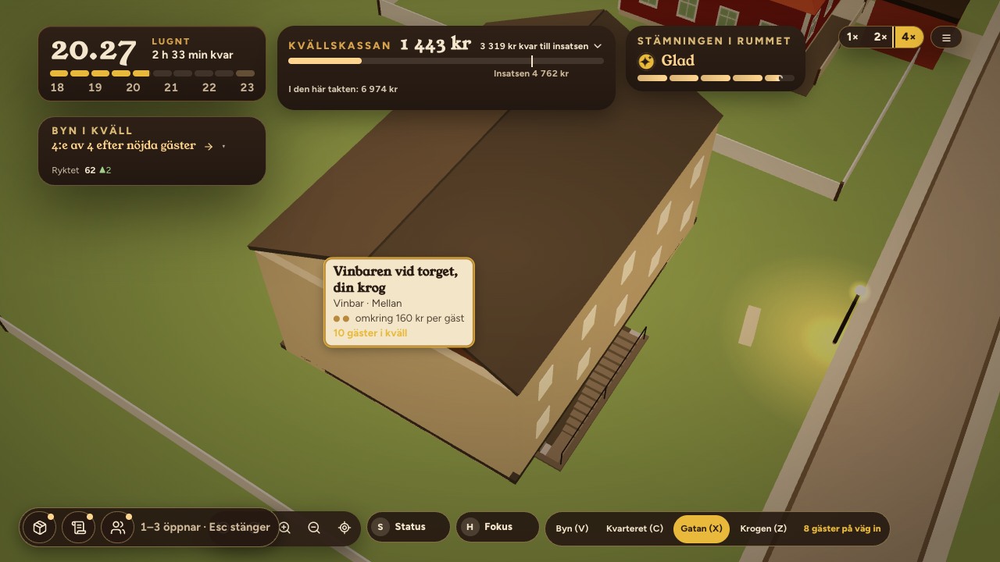
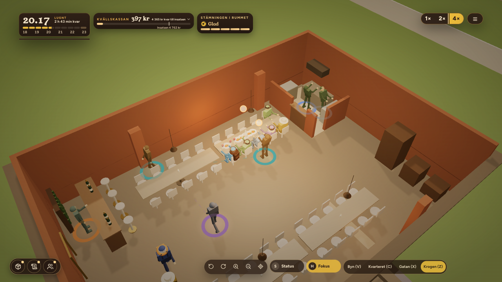

# ORDER 336 — salongen, källardörren och stamgästerna (rapport)

*Anders 2026-10-22. Gren `order-336` från main `0071a3ad`.*

**Beslut under ordern:**
- Källaren sänks hela vägen som i D15. Anders valde det när det stod klart att trappan ned kräver ett golv under gatan.
- Två tillägg före merge: värdpulten vid den nya ingången, och en kameravinkel där trappan syns.

**Att avgöra:** frågorna under *Öppet* sist.

## A. Salongen
- **Hela salongen har åtta runda bord med vit duk**, som i D15 (`scene/tablePlans.ts SALON_PLAN`). Tre står i vinbarens del, norr om baren och i sydöst, och fem väster om mellanväggen.
- **Soffgruppen vid kakelugnen** har tre platser.
- **Vinbarens bar står kvar i östra änden,** med vinväggen men utan barpallar, lounger, tvåor och DJ.
- **Platserna:** 35, som D15. Gångarna går runt borden och genom öppningen i mellanväggen.
- **Bilder:** `frontend/reports/order336/bilder/salongen-krogen.png` och `salongen-hela.png` (`scripts/order336-bilder.mjs`; `bilder.json` A, inga fel på sidan).
- **Test:** `scene/__tests__/order336Salongen.test.ts`. Vägarna till varje plats och personalens vägar till varje sällskap prövas i `order335Planlosningar.test.ts`.

## B. Källaren under gatan
Spec och data: `tablePlans.ts CELLAR_DOOR`, efter D15 `VENUES.kallaren`.

**Rummet och marken:**
- Golvet ligger 2,7 m under gatan. Rummets grupp sänks, och figurerna följer med.
- Marken har ett hål över gropen och trappan. Rutorna som hålet berör ersätts av en lapp med samma färger (`OsmTerrain.tsx`, `premisesInterior.ts cellarHoleWorld`).
- Murarna går upp till gatan och står kvar vid Z.

**Dörren och trappan:**
- Dörren sitter i norra långsidan, som i D15: x 5,2, bredd 1,1 m. Östra väggen är hel.
- Trappan har fjorton steg och går ned längs fasaden till ett vilplan framför dörren, med räcke mot gatan.
- Huset ovanpå står på gatan och tonar ut med taket vid Z.

**Gästerna utanför och innanför:**
- Kön står på gatan längs norra fasaden, väster om trappans början.
- Gästerna går nedför trappan till dörren (`wineBarRoom.ts doorPathFor`).
- Figurerna har markens höjd i trappan och på gatan (`planGroundLift`).
- Dörrpunkten i byn ligger vid trappans början (`villagePlaces.ts`).
- AW-skylten står på gatan vid trappans början.

**Värdpulten (tillägg)** står innanför dörren vid trappans fot, med framsidan mot dörren. Värden står bakom den, vänd mot dörren. Kön innanför står på andra sidan dörren (`CELLAR_DOOR.hostDesk`, `host`).

**Kameran (tillägg):**
- Källaren har en egen standardvinkel vid Gatan (X) och Krogen (Z). Kameran står på den norra sidan, snett från öster (`camera/eveningLevels.ts PREMISES_YAW`).
- Vridknapparna på skärmen vrider kameran på båda nivåerna. Tangenterna q och e gör det bara i playtest-läge.

**Bilder från spelarens kamera** (`bilder.json` B, inga fel på sidan):
- Vid Gatan syns trappan längs fasaden med räcket:

  

- Vid Krogen syns gropen, dörren och värdpulten. Trappan ligger precis nedanför bildkanten:

  

**Test:** `order336Salongen.test.ts`. Det prövar:
- dörren och den hela östra väggen;
- kön på gatan i gatans höjd;
- att vägen nedför trappan sjunker hela vägen och bara passerar muren i dörren;
- murarna, de fjorton stegen och huset;
- att hålet rymmer rummet och trappan, och att kön står utanför det;
- värdpulten;
- att inga möbler står i trappan.

## C. Stamgästerna från Magasinsgatan
- **Vid vagnen** blir stamgästerna fyra fler per kväll, med taket 30 (`balance.ts DISTRICTS.magasinsgatan`).
- **När vinbaren tas över följer hälften med** (`followShare` 0,5), räknat på sista kvällens stamgäster (`districts.ts followingRegularsAtTakeover`, `ladder.ts`).
- **I krogen** kommer de varje kväll som bybor. Konceptet gör dem inte till turister.
- **De syns i rummet** i samma kläder som vid vagnen (`truckGuestFlow.ts regularLook`) och med samma kopp i handen (`WineBarFigures.tsx`). I produktionsbygget hade alla stamgäster i rummet sin kopp (`bilder.json` C: `withCup` = `tonight`).
- **Kvällens resultat** säger hur många som kom.

**I krogen är stamgästerna ett golv, inte fler gäster ovanpå** (`economy.ts dailyGuestCap`). Den första mätningen lade dem ovanpå kvällens gäster:
- Vinbaren vid Torget fylldes ändå.
- Stamgästerna trängde undan andra, och lagret köptes in för fler än rummet tog.
- Ryktet sjönk, och den mittersta spelartypens kassa vid säsongens slut föll från 23 598 till 14 411 kr.

Som golv kommer de också en tunn kväll, men en full kväll är de bland gästerna. Vid vagnen ligger de ovanpå som förut, eftersom Magasinsgatan har få gäster.

## D. Mätningen
40 frön per rad (`reports/order336/lokaler.json`, `scripts/order336-lokaler.sh`, `order336-jamforelse.mjs`). Före: lokalerna ur ORDER 335 och Magasinsgatan ur ORDER 334.

| Rad | Stängda | Medelkassa | Omförhandlat | Bistron |
|---|---|---|---|---|
| Källaren, mentorn (stark) | 1/40 | 21 312 | 35 | 2 |
| Källaren, rimlig (mitten) | 0/40 | 24 614 | 38 | 0 |
| Källaren med AW, mentorn | 0/40 | 39 661 | 13 | 29 |
| Källaren med AW, rimlig | 0/40 | 34 407 | 19 | 0 |
| Salongen, mentorn | 0/40 | 41 396 (förut 39 175) | 12 | 40 |
| Salongen, rimlig | 0/40 | 33 124 (förut 37 269) | 17 | 0 |
| Flygeln, mentorn / rimlig | 0/40 / 0/40 | 26 318 / 20 544 | 15 / 26 | 25 / 0 |
| Magasinsgatan, mentorn | 0/40 | 36 065 (förut 29 866) | 36 | 32 |
| Magasinsgatan, rimlig | 0/40 | 21 480 (förut 23 598) | 36 | 0 |

- **Källaren och Flygeln** är lika med ORDER 335 i alla fält: B ändrar bara scenen, och simuleringen räknar inte med trappan.
- **Salongen:** de runda borden ger mentorn mer och den rimliga mindre än vinbarens möblering med salongens 15 platser gjorde.
- **Magasinsgatan:** i medel följer 15 stamgäster med till vinbaren. Stamgästerna vid vagnen är 8 per kväll de första kvällarna, 26 efter 5–9 kvällar och 30 därefter (`byNight`).
  - Den starka spelartypen slutar säsongen med 6 199 kr mer än förut.
  - Den mittersta slutar med 2 118 kr mindre. Det kommer från vagnsveckorna: med fler stamgäster vid vagnen blir kön längre, och ryktet vid första avräkningen är 0,753 mot 0,789 förut.
- **Målen från ORDER 334 håller:** källaren utan AW stänger 1 av 40 för den starka spelartypen, och med AW 0 av 40 för den mittersta.

## E. Sviten
Hela sviten kördes ensam före merge: 243 filer, 2 929 tester gröna (1 väntat fel, 26 överhoppade). Typkontrollen och bygget är gröna.

## Öppet
1. **Bistron per lokal** väntar en order, enligt Anders beslut. Bistron har 31 platser i alla lokaler.
   - **Känd lucka:** bistron i källaren är inte byggd under gatan. Rummet står i gatuplan med bistrons dörr i öster, men hålet i marken runt källaren finns kvar.
   - Spelaren når bistron först efter vinbaren, och testerna kör inte den vägen.
   - Det rättas i ordern om bistron per lokal.
2. **Kön vid vagnen på Magasinsgatan:** med +4 per kväll blir kön längre än vagnen hinner med, och ryktet sjunker något. Ska stamgästerna vid vagnen också vara ett golv, eller ska vagnen få fler i kön?
3. **Krogens kamera vid Z:** trappan ligger precis nedanför bildkanten. Kameran kan stå längre bort eller lägre i källaren, men då ändras teaterns kamera där.
