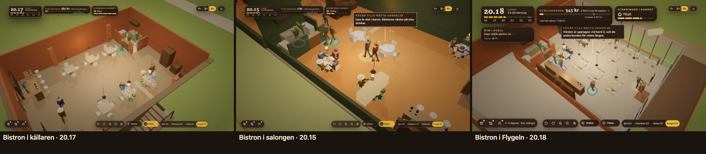

# ORDER 337 — bistron per lokal (rapport)

*Anders 2026-10-22. Gren `order-337` från main `b67e27dc`.*

**Att avgöra:** frågorna under *Öppet* sist.

## A. Bistron per lokal
Bistron har en egen planlösning i varje lokal, med samma form som vinbarens i ORDER 335–336 (`scene/tablePlans.ts`: `BISTRO_CELLAR_PLAN`, `BISTRO_SALON_PLAN`, `BISTRO_WING_PLAN`). Platserna följer lokalens storlek (`reports/order337/bistron.json`):

| Lokal | Platser | Planlösningen |
|---|---|---|
| Torget | 31 | som förut (Designs D7, `bistroHouse.ts`) |
| Källaren | 28 | under gatan med trappan, dörren i norra långsidan och värdpulten vid trappans fot; källarens bar längs östra väggen med fyra pallar och sex bord för fyra |
| Flygeln | 44 | pallarna längs glaset i söder, åtta bord för fyra i två rader, baren mot norra väggen bort från glaset |
| Salongen | 46 | salongens åtta runda bord med vit duk och två där vinbarens ö stod, soffgruppen vid kakelugnen, och en bistrobar mot norra väggen i nordost med tre pallar |

- **Varför källaren har färre platser än Torget:** golvet är lika stort, men baren längs väggen och vilplanet vid dörren tar plats.
- **Varför Flygeln har färre än salongen:** bistron står i vinbarens del av flygeln, det sydöstra hörnet med glaset. Flygelns norra del är inte möblerad.
- **Bistrons kännetecken i alla lokaler:**
  - bistrons golv och pendlar över borden;
  - hyllan med flaskor bakom baren, och ingen vinvägg;
  - ombyggnadens fyra steg under de stängda dagarna, som vid Torget (`wineBarRoom.ts setRefitPhase`).
- **I simuleringen** följer kapaciteten, sällskapens grupper och ordningen platserna fylls i lokalens bistroplan (`simulation/service.ts premisesSeats`).
- **Luckan från ORDER 336 är borta:** bistron i källaren ligger nu under gatan som vinbaren. Rummet och hålet i marken stämmer.
- **Bilder** från produktionsbygget, med dörrarna öppna och vid Z (`scripts/order337-bilder.mjs`; `bilder.json` A, inga fel på sidan):

  

- **Test:** `scene/__tests__/order337Bistron.test.ts`. Det prövar:
  - platserna i rummet och i simuleringen, och storleksordningen mellan lokalerna;
  - källaren under gatan, Flygelns glas och salongens runda bord;
  - att det finns en hylla och ingen vinvägg;
  - att varje plats står fri;
  - att gästernas väg till varje plats och personalens väg till varje sällskap inte går genom möbler;
  - att lokalens rekvisita inte står på platserna.

## B. Stamgästerna vid vagnen
- **Väntan i kön sänker inte ryktet för stamgästerna:** deras nöjdhet sjunker inte i kön, och de går inte ur den (`simulation/service.ts`, `Guest.spotRegular`). Test: `sim/__tests__/order336Stamgaster.test.ts`, där stamgästen står kvar med samma nöjdhet medan en annan gästs nöjdhet sjunker.
- **Taket vid vagnen är 20,** förut 30 (`balance.ts DISTRICTS.magasinsgatan.regularsMax`).
- **I krogen gäller golvet som förut.** Hälften av sista kvällens stamgäster följer med, i medel nu 10 (förut 15).

## C. Namnet i spelarens flöde
Kontrollerat i produktionsbygget (`scripts/order337-bilder.mjs`; `bilder.json` C, inga fel på sidan). Skriptet utgår från sparfilen med vagnen och Åsas erbjudande om vinbaren. För varje lokal: kortet, lokalen, Till banken, ett eget namn och Ta över.

| Lokal | Bankens fråga | Rubriken på morgonen | Skylten vid Gatan |
|---|---|---|---|
| Källaren | "Banken lånar ut till en vinbar i källaren på Prästgatan. Vad ska den heta?" | Valvet | Valvet, din krog |
| Salongen | "… i salongen nära Gästgivaregården …" | Kakelugnen | Kakelugnen, din krog |
| Flygeln | "… i Flygeln på campus …" | Glasrummet | Glasrummet, din krog |

- **"Vid torget" står inte i någon av texterna** (`torgetInText` false).
- **Rättat:** rubriken på Åsas erbjudande sa "Vinbaren vid Prästgatan" oavsett lokal. Nu står "Vinbaren", eftersom lokalen väljs i kortet.
- **Skylten och morgonens rubrik läste redan bankens namn.** Att "Vinbaren vid torget" syntes i ORDER 333–336:s bilder kom från namnet i sparfilen som skripten använde (`reports/order284/save-mandag-vinbaren.json`), inte från spelet.
- **Skylten är läst ur sidan:** bilden vid Gatan visar morgonens skärm över byn, så skyltens text är läst ur sidan (`player-sign`).

## D. Mätningen
40 frön per rad (`reports/order337/lokaler.json`, `scripts/order337-lokaler.sh`, `order337-jamforelse.mjs`). Före är ORDER 336:s körning.

| Rad | Stängda | Medelkassa (förut) | Bistron |
|---|---|---|---|
| Källaren, mentorn | 1/40 | 21 302 (21 312) | 2 |
| Källaren med AW, mentorn | 0/40 | 42 507 (39 661) | 29 |
| Salongen, mentorn | 0/40 | 42 941 (41 396) | 40 |
| Flygeln, mentorn | 0/40 | 27 904 (26 318) | 25 |
| Källaren, salongen och Flygeln, rimlig | 0/40 | oförändrat | 0 |
| Magasinsgatan, mentorn | 0/40 | 32 998 (36 065) | 32 |
| Magasinsgatan, rimlig | 0/40 | 22 002 (21 480) | 0 |

- **Bistron per lokal** ändrar bara säsonger som når bistron. Mentorns kassa vid säsongens slut stiger med 1 500–2 800 kr i salongen, Flygeln och källaren med AW.
  - Den mittersta spelartypen når inte bistron, så dess rader är lika i alla fält.
  - Källaren utan AW når bistron i bara 2 säsonger, så kassan där är nästan oförändrad.
- **Magasinsgatan:** med taket 20 följer 10 stamgäster med i stället för 15.
  - Mentorns kassa vid säsongens slut sjunker med 3 067 kr.
  - Den mittersta får 522 kr mer, eftersom kön inte längre sänker ryktet.
- **Målen från ORDER 334 håller:** källaren utan AW stänger 1 av 40 säsonger för den starka spelartypen, och med AW stänger den mittersta 0 av 40.

## E. Sviten
Hela sviten kördes ensam före merge: 244 filer, 2 934 tester gröna (1 väntat fel, 26 överhoppade). Typkontrollen och bygget är gröna.

## Öppet
1. **Flygelns norra del:** bistron, liksom vinbaren, står i det glasade hörnet. Ska bistron i Flygeln ta hela flygeln (D15 cirka 270 m²) med fler bord i den norra delen? Det kräver en öppning i mellanväggen, som i salongen.
2. **Stamgästerna som följer med** är nu 10 (hälften av 20). Ska andelen höjas nu när taket vid vagnen är lägre?
