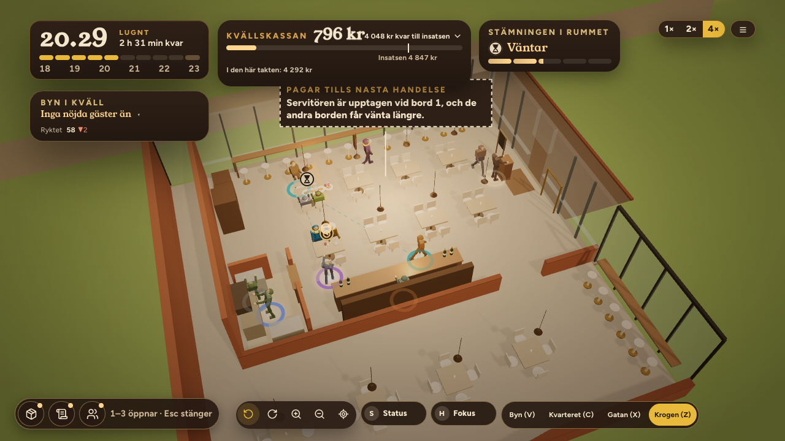

# ORDER 338 — Flygeln hel (rapport)

*Anders 2026-10-22. Gren `order-338` från main `7b29d78c`.*

**Att avgöra:** frågan under *Öppet* sist.

## Bistron i hela flygeln
Planen står i `scene/tablePlans.ts` (`BISTRO_WING_PLAN`, `WING_OPENING`), mellanväggen i `scene/premisesInterior.ts`.

- **Öppningen i mellanväggen:** rummets norra vägg, mot flygelns norra del, är en mellanvägg med en öppning öster om baren (x 3,0–5,0 i rummets lokala ram), som salongens. Över öppningen sitter ett överstycke.
- **Den norra delen** är möblerad efter rummets storlek: fyra bord för fyra i en rad och sex pallar vid fönsterbänken längs östra glaset. Det blir 22 platser på cirka 105 m², samma täthet som bistron vid Torget (31 platser på 145 m²). Pallarna vid bänken är platser i bistron. I vinbaren är de fortfarande rekvisita.
- **Platserna:** 66 i bistron i Flygeln, varav 44 i det glasade hörnet som i ORDER 337 och 22 i den norra delen (`reports/order338/platser.json`). Simuleringens kapacitet följer planen.
- **Gångarna:** gången går från den norra gången framför baren genom öppningen till den norra delen. Där går den framför borden, bakom dem, mellan borden och vid fönsterbänken. Gästerna och personalen går den vägen.
  - Testet prövar att gästernas väg till varje plats i den norra delen och personalens väg till varje sällskap där går genom öppningen och inte genom mellanväggen.
  - Det prövar också att mellanväggen inte har något i öppningen.
  - Det prövar att alla platser ligger inne i flygeln (`scene/__tests__/order338FlygelnHel.test.ts`).
  - Att vägarna inte går genom möbler prövas för alla platser i `order337Bistron.test.ts`.
- **Rättat på vägen:** platserna i den norra delen räknades som köket, eftersom köksgränsen saknade en norra kant. Vägen dit gick då genom kallskänken. Köket slutar nu vid rummets norra vägg (`tablePlans.ts inKitchen`).
- **Bilder** från produktionsbygget, med bistron i Flygeln och dörrarna öppna (`scripts/order338-bilder.mjs`; `bilder.json`, inga fel på sidan):
  - `flygeln-z.png`: nivån Krogen.
  - `flygeln-hela.png`: ett steg ut och vriden med vridknapparna, så att den norra delen syns.

## Mätningen
40 frön, vinbaren och bistron i Flygeln (`reports/order338/flygeln.json`, `scripts/order338-flygeln.sh`, `order338-jamforelse.mjs`). Före är ORDER 337:s körning, med bistron i det glasade hörnet.

| Rad | Stängda | Medelkassa (förut) | Lägsta kassa | Bistron |
|---|---|---|---|---|
| Flygeln, mentorn (stark) | 0/40 | 27 853 (27 904) | 15 581 | 25 |
| Flygeln, rimlig (mitten) | 0/40 | 20 544 (20 544) | 1 393 | 0 |

- **De 22 nya platserna ändrar nästan ingenting.** Mentorns kassa vid säsongens slut är 51 kr lägre, och resten är lika.
  - Gästerna begränsas av marknaden, alltså kvällens tak och ryktet, och inte av rummet. Redan 44 platser räckte för de gäster som kom.
  - Mentorn når bistron i 25 av 40 säsonger, och sent, så kvällarna i bistron är få.
- **Den mittersta spelartypen når inte bistron**, så dess rad är lika i alla fält.

## Sviten
Hela sviten kördes ensam före merge: 245 filer, 2 936 tester gröna (1 väntat fel, 26 överhoppade). Typkontrollen och bygget är gröna.

## Öppet
1. **Platserna fylls inte.** Bistron i hela flygeln har plats för fler gäster än som kommer. Ska bistrons marknad, alltså kvällens tak, växa med lokalens storlek? Annars är en större lokal bara ett utseende och inget val med följder.
