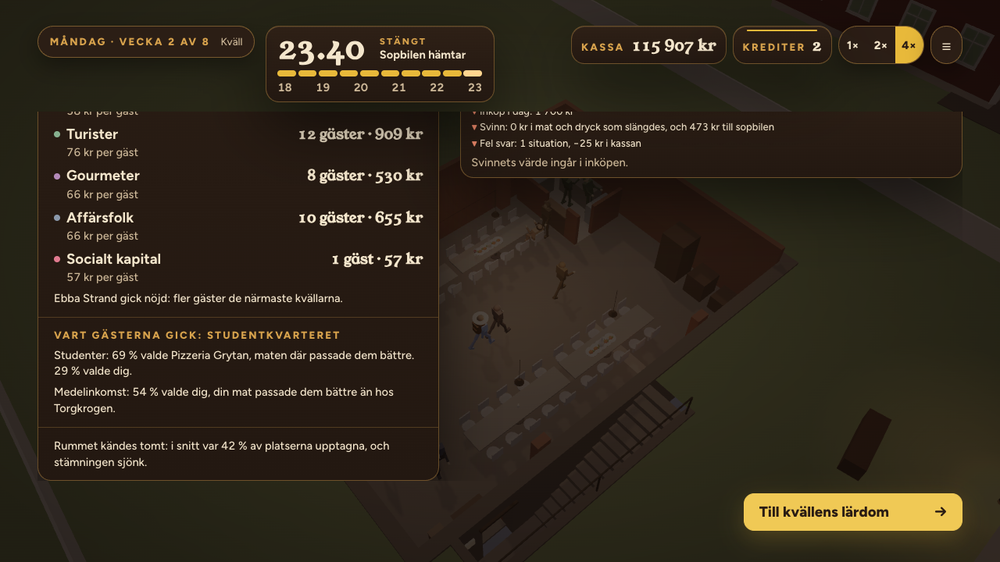

# ORDER 339 — storleken har följder (rapport)

*Anders 2026-10-22. Gren `order-339` från main `4f9685b4`.*

**Att avgöra:** frågorna under *Öppet* sist.

Talen för storleken står på ett ställe, `sim/premisesScale.ts`. Konstanterna ligger i `balance.ts`: `MARKET.premisesSeatExponent`, `PREMISES_SCALE` och `EMPTY_ROOM`. Allt mäts mot klassens rum vid Torget, där vinbaren har 20 platser, bistron 31 och lokalen 145 m². Torget räknas därför som förut, med alla faktorer 1.

Faktorerna per lokal och steg står i `reports/order339/storleken.json`. Den skrivs av `src/sim/__tests__/order339Storleken.test.ts` med `WRITE_REPORTS=1`.

| Lokal | Steg | Platser | Taket × | Laget (tempo) × | Lönerna × | Hyran (yta) × | Veckohyra |
|---|---|---|---|---|---|---|---|
| Torget | vinbar / bistro | 20 / 31 | 1 / 1 | 1 / 1 | 1 / 1 | 1 | 13 469 |
| Källaren | vinbar / bistro | 44 / 28 | 4,84 / 0,82 | 1,74 / 0,93 | 1,37 / 0,96 | 1,00 | 9 409 |
| Salongen | vinbar / bistro | 35 / 46 | 3,06 / 2,20 | 1,48 / 1,32 | 1,25 / 1,17 | 1,24 | 16 667 |
| Flygeln | vinbar / bistro | 36 / 66 | 3,24 / 4,53 | 1,51 / 1,70 | 1,27 / 1,35 | 1,21 | 16 230 |

## A. Kvällens tak växer med platserna
- Kvällens tak (`economy.ts dailyGuestCap`) multipliceras med `premisesCapK`. Det är platserna i lokalens plan (`tablePlans.ts`) delat med Torgets för samma steg, upphöjt till `MARKET.premisesSeatExponent = 2`.
- Efterfrågan multiplicerar som förut: kvarteret, kvällens andel (rykte, väder, konkurrens), surret, DJ:n och stamgästerna. Taket säger hur många som *kan* komma, och efterfrågan hur många som gör det.
- Exponenten 2 valdes i kalibreringen (körningarna kal1–kal7 i `reports/order339/`, 10 frön var). Sedan ORDER 338 fylldes de stora rummen inte (`order338/flygeln.json`).
- Test: `order339Storleken.test.ts` A. Med samma lokal och kväll är taket med platserna lika med taket utan dem gånger faktorn.

## B. En större lokal kostar
- **Hyran följer ytan** (`economy.ts weeklyRentSek`): yta delat med Torgets, upphöjt till `PREMISES_SCALE.areaExponent = 0,3`.
  - Ytorna (`PREMISES_SCALE.areaM2`): Torget 145, källaren 144, salongen 295 med köket och Flygeln 270.
  - Källaren har kvar sin rabatt (`DISTRICTS.premisesRentK`).
- **Laget följer platserna.**
  - Lönerna (`economy.ts dailyWagesSek`) växer med `premisesWageK`, platserna mot Torgets upphöjt till 0,4.
  - Tempot växer med `premisesTeamK`, upphöjt till 0,7. Uppgifternas tid i servicen delas med det (`service.ts`), och kökets mise en place hinner det gånger mer (`miseEnPlace.ts`).
  - Det större laget gör att väntan inte växer med rummet. Lönerna växer långsammare än laget, så ett större lag kostar mindre per person.
  - Laget syns inte som fler figurer. Se *Öppet* 3.
- Test: `order339Storleken.test.ts` B. Hyran är Torgets gånger ytans faktor, och lönerna Torgets gånger lagets.

## C. Ett halvtomt rum
- **Regeln:** från kl. 19 sjunker rummets stämning (`day.roomMoodLift`) när färre än 30 % av platserna är upptagna (`EMPTY_ROOM.threshold`). Den sjunker med 0,004 per spelminut, ned till −0,08 (`reducer.ts emptyRoomTick`).
  - Rummets stämning läser notan, gästernas gester och stämningsbubblor i rummet (`WineBarFigures.tsx`), statuskortet och mätaren.
  - Foodtrucken har inga platser och påverkas inte.
- **Kvällens resultat** visar raden *"Rummet kändes tomt: i snitt var {pct} % av platserna upptagna, och stämningen sjönk."* (`result.emptyRoom`, sv och en). Raden visas när rummet varit halvtomt i minst 45 spelminuter, och procenten är medelbeläggningen från kl. 19.
- **Rättat på vägen:** raden låg först inne i panelen om vart gästerna gick. Den panelen visas inte när den saknar rader, och då försvann raden med den. Nu är raden en egen rad, `EmptyRoomLine` i `ResultScreen.tsx`.
- **Spelarens flöde i produktionsbygget** (`scripts/order339-tomt.mjs`, `reports/order339/tomt.json`, inga fel på sidan):
  - Sparfilen är måndag i vinbaren, med lokalen källaren (44 platser). Dörrarna öppnas, farten är 4×, och raketerna besvaras.
  - Kvällen går genom sopbilen, överföringen och resultatet (`sequence`), och resultatet visar raden med 42 % beläggning (`emptyRoom`).
  - I salongen (35 platser) var rummet samma kväll inte halvtomt, och raden kom inte. Det är som det ska vara.
  - Bilderna: `bilder/tomt-krogen.png` kl. 20.17 (nivån Krogen) och `bilder/tomt-resultat.png`.

## D. Spelartyperna per lokal
40 frön per rad, vinbaren och bistron (`scripts/order339-lokaler.sh`, `order339-jamforelse.mjs`, `reports/order339/lokaler.json`).
- *Före* är körningarna utan storleken: ORDER 337 (`order337/lokaler`) och för Flygeln ORDER 338 (`order338/flygeln`).
- Mentorns plan köper nu efter kvällens bokning, med högst fyra baspaket (`weekHarness.ts stock: 'booking'`). Det är så en stark spelare handlar i en större lokal. Mentorns före och efter skiljer sig alltså också i planen.
- Torget har ingen före-rad.

Medelkassan vid säsongens slut i kronor, med före inom parentes. Ingen säsong stängdes. Hela tabellen står i `lokaler.json`.

| Lokal | Mentorn (stark) | Rimlig (mitten) |
|---|---|---|
| Flygeln | **71 434** (27 853) | 51 833 (20 544) |
| Salongen | 61 408 (42 941) | 52 143 (33 124) |
| Källaren med AW | 55 784 (42 507) | 56 608 (34 407) |
| Torget | 42 125 (—) | 28 960 (—) |
| Källaren | 22 047 (21 302) | **71 770** (24 614) |

- **Ingen lokal är alltid bäst.** Flygeln är bäst för mentorn och fyra av fem för den rimliga. Källaren är bäst för den rimliga och sämst för mentorn (`lokaler.json goal`).
- **Den stora lönar sig för den starka spelaren och inte för den mittersta.**
  - Mentorn når bistron i alla 40 säsonger i varje lokal, och bistron i Flygeln har 66 platser.
  - Den rimliga når inte bistron och har vinbarens platser, 36 i Flygeln mot 44 i källaren. Den betalar Flygelns hyra utan bistrons tak.
- **Men alla lokaler slår Torget för båda spelartyperna.** Att flytta lönar sig alltid. Det är valet av lokal som har följder, inte valet att flytta. Se *Öppet* 1.
- **Källaren vänder:** vinbaren i källaren har 44 platser, fler än i salongen och Flygeln. Bistron i källaren har 28, färre än Torgets 31. Taket i källaren krymper därför när mentorn tar bistrosteget (4,84 → 0,82), och mentorn omförhandlar lånet i 35 av 40 säsonger. Se *Öppet* 2.

## Sviten
Hela sviten kördes ensam: 246 filer och 2 942 tester gröna (1 väntat fel, 26 överhoppade). Typkontrollen och bygget är gröna.

Två tester ändrades.
- `order334Lokalerna.test.tsx` krävde att salongen hade Torgets hyra. Nu följer hyran ytan (B), och testet räknar med ytans faktor.
- I `order339Storleken.test.ts` A gick tiden ut i hela sviten, eftersom economy-modulen importerades sex gånger. Den importeras nu två gånger.

## Öppet
1. **Att flytta lönar sig alltid.** Med taket efter platserna tjänar båda spelartyperna mer i varje lokal än vid Torget. Ska flytten kosta mer, till exempel genom handpenningen eller en högre hyra (exponenten 0,3)? Eller är det rätt att flytten belönas och att valet av lokal är beslutet?
2. **Källarens platser.** Vinbaren i källaren har 44 platser (ORDER 336) men bistron bara 28 (ORDER 337). Den starka spelaren förlorar på att ta bistrosteget i källaren. Ska bistron i källaren ha fler platser, eller ska vinbaren där ha färre?
3. **Laget syns inte.** Det större laget i en större lokal är bara tempo och löner, inga fler figurer i rummet. Det bryter mot grundregeln att varje val syns (`ORDER_100_VISION.md` > EVERY CHOICE IS SEEN). Fler i personalen per lokal behöver figurer och platser i rummet. Det redovisas som ofullständigt tills det finns.
4. **Det tomma rummet sänker stämningen lite.** Högst −0,08 på rummets stämning. Kl. 20.17 i källaren visade mätaren inget tomt rum, eftersom rummet tömdes senare på kvällen. Ska det kännas mer?
